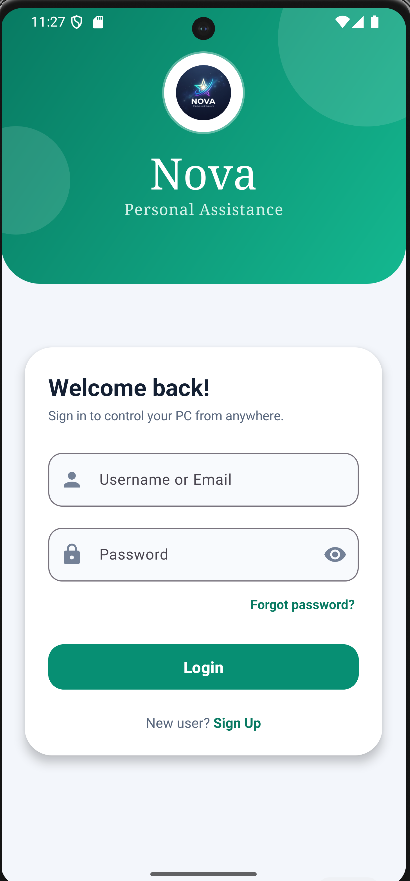
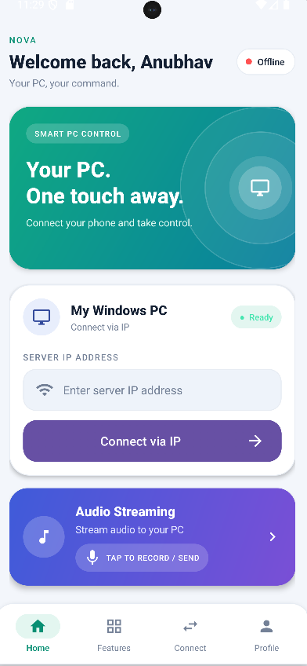
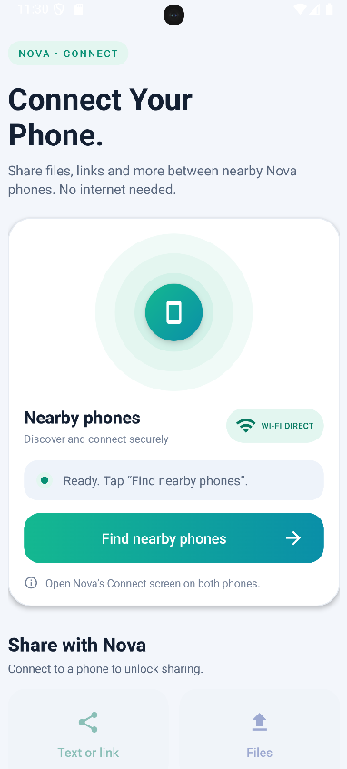
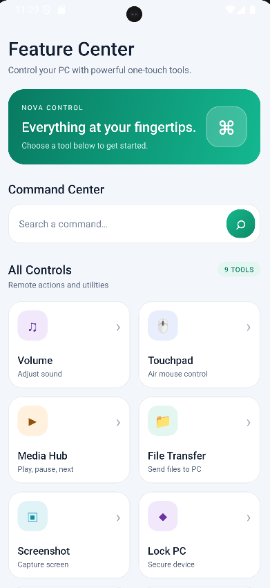

# 🚀 NOVA PC Controller

**Control Your PC. From Your Phone.**

NOVA PC Controller is an Android-based remote PC control application designed to connect an Android smartphone to a Windows computer over a local network.

The project aims to provide a simple, modern, and convenient way to interact with a PC using a smartphone. With a dedicated Android application and a Python-based Windows companion server, NOVA creates a communication bridge between mobile devices and computers.

## ✨ Features

- **PC Connection:** Connect your Android device to your Windows PC using an IP address and local network connectivity.
- **Device Discovery:** Discover compatible PCs on the network through UDP-based discovery.
- **Command Center:** Access PC control features through a centralized dashboard.
- **Audio Streaming:** Dedicated section for audio-related functionality.
- **Smart Navigation:** Modern interface with organized feature categories.
- **Recent Activity:** Access recent actions and activity.
- **Wi-Fi Communication:** Communicate between Android and Windows using network sockets.
- **Windows Companion Server:** Python-based server designed to handle incoming connections from the Android application.
- **Modern UI:** Clean and user-friendly Android interface.

## 🛠️ Technology Stack

### Android Application
- Java
- XML
- Android Studio
- Android SDK

### Windows Companion Server
- Python
- Socket Programming
- UDP Device Discovery
- TCP Communication

### Communication
- Local Wi-Fi Network
- UDP Discovery Port: `8989`
- TCP Transfer Port: `8988`

## 🏗️ Project Architecture

NOVA uses a client-server architecture.

1. The Android application acts as the client.
2. The Windows companion application runs the Python server.
3. The Android device discovers or connects to the PC.
4. Communication takes place through network sockets.
5. The server processes supported requests and sends responses.

## 📱 Application Workflow

1. Install and open NOVA on your Android device.
2. Start the NOVA Windows Companion server on your PC.
3. Connect both devices to the same local network.
4. Discover your PC or enter its IP address.
5. Establish the connection.
6. Access the available PC control features.

## 📂 Project Structure

```text
NOVA-PC-Controller/
│
├── Android/
│   └── NOVA-Android-App/
│       ├── app/
│       ├── gradle/
│       └── build.gradle
│
├── Windows-Companion/
│   ├── server.py
│   ├── requirements.txt
│   └── README.md
│
├── docs/
│   ├── screenshots/
│   └── architecture/
│
├── .gitignore
└── README.md
```

*The folder structure above is a suggested organization. Adjust it to match the actual repository.*

## 🔒 Security

NOVA is intended for trusted devices on a local network.

Security improvements should include:
- Authenticated device pairing.
- Secure command validation.
- Restricted access to sensitive PC operations.
- Safe handling of incoming network requests.
- Encrypted communication where supported.

Do not expose the companion server directly to the public internet without appropriate security protections.

## 🚧 Future Enhancements

- Automatic PC discovery and connection.
- Improved two-way communication.
- Advanced media and audio controls.
- File transfer between Android and Windows.
- Customizable remote control features.
- Connection status and diagnostics.
- Secure device pairing.
- Windows companion application with automatic server startup.

## 🎯 Project Objective

The main objective of NOVA PC Controller is to make PC interaction more convenient by transforming an Android smartphone into a smart remote control for a Windows computer.

## 👨‍💻 Development

This project is developed as a personal software development project using Android Java and Python.

## 📄 License

This project is currently available for educational and personal development purposes. A formal open-source license can be added when the project owner chooses one.
## 📸 NOVA PC Controller Screenshots

### Login Dashboard


### 1. Home Dashboard



### 2. Nova Connect



### 3. Feature Dashboard




